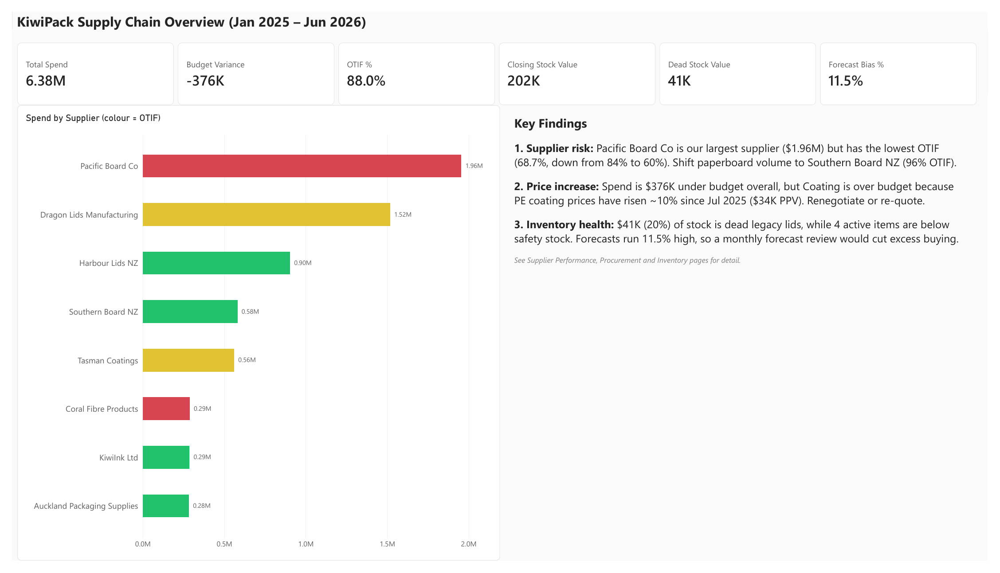
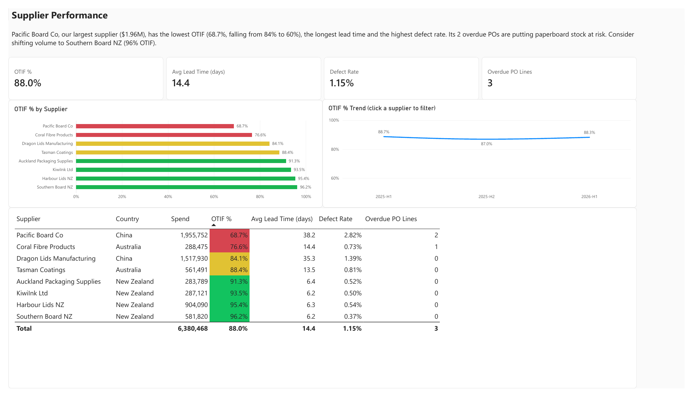
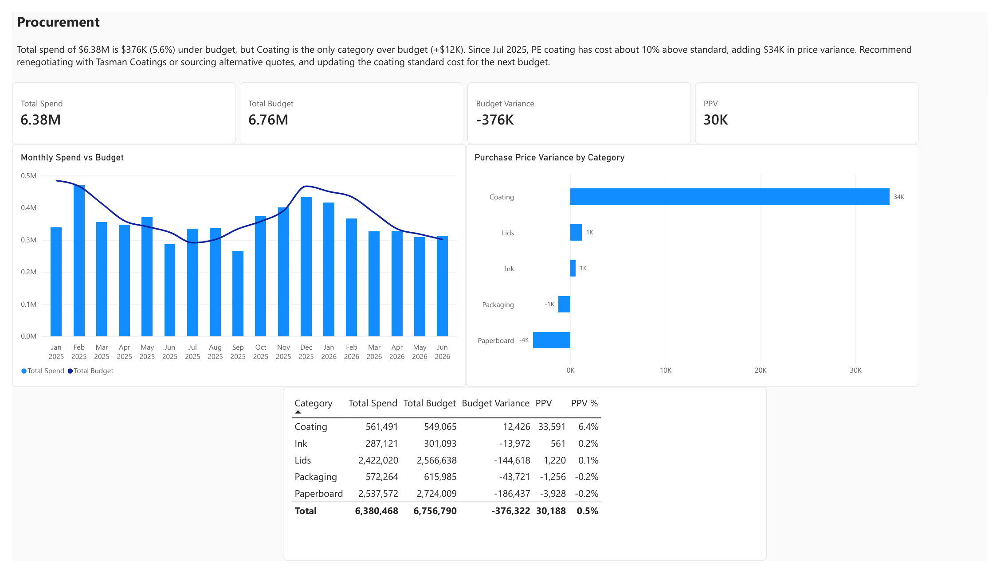
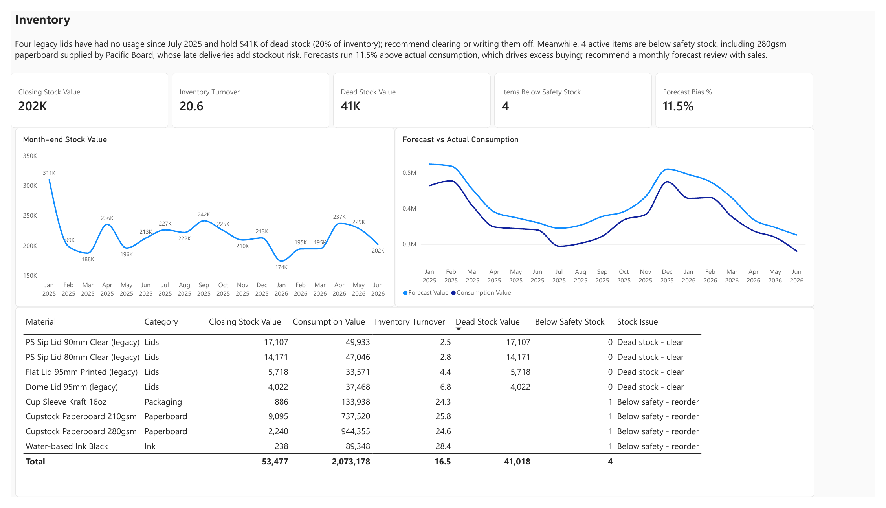
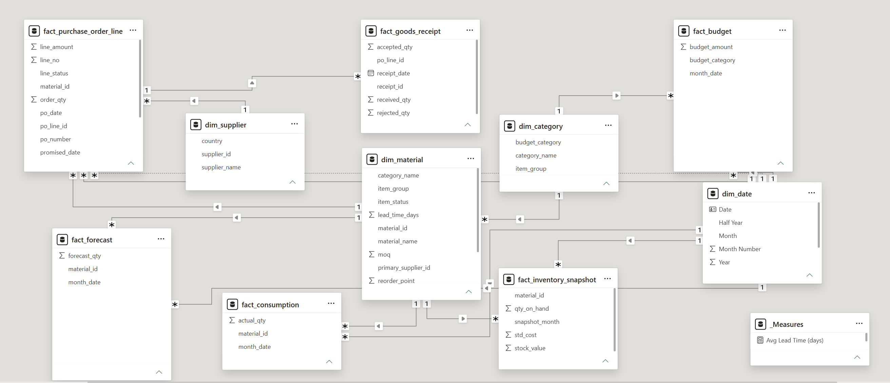

# KiwiPack Supply Chain Analytics

End-to-end supply chain analysis for **KiwiPack**, a fictional Auckland paper cup and packaging manufacturer (Jan 2025 – Jun 2026).

Raw ERP exports → **SQL** profiling, cleaning and star schema → **Power BI** data model, DAX measures and 4 dashboard pages → business recommendations.

> The data is synthetic. I generated it with Python to look like real ERP exports, including the messy parts (duplicates, inconsistent names, text dates), so the project covers the full analyst workflow rather than starting from a clean dataset.



---

## Business questions

| Area | Question | KPI |
|---|---|---|
| Supplier | Which suppliers deliver on time and in full? | OTIF %, lead time, defect rate |
| Procurement | Are we spending within budget? Are we paying more than standard cost? | Budget variance, PPV |
| Inventory | Is stock tied up in slow items? Are any items at risk of running out? | Turnover, dead stock, items below safety stock |
| Planning | How accurate is the demand forecast? | Forecast bias, MAPE |

## Key findings

1. **Supplier risk:** Pacific Board Co is the largest supplier ($1.96M) but has the lowest OTIF: 68.7% overall, falling from 84% to 60%. It also has the longest lead time (38 days) and the highest defect rate (2.8%). Southern Board NZ supplies the same paperboard at 96% OTIF with a 6-day lead time. **Recommendation:** shift paperboard volume to Southern Board NZ.
2. **Price increase:** Total spend is $376K (5.6%) under budget, but Coating is the only category over budget (+$12K). PE coating prices have been about 10% above standard cost since Jul 2025, adding $34K of purchase price variance. **Recommendation:** renegotiate or re-quote, and update the coating standard cost for the next budget.
3. **Inventory health:** Four legacy lids have had no usage since Jul 2025 and hold $41K of dead stock (20% of inventory). At the same time, 4 active items are below safety stock, including 280gsm paperboard from Pacific Board. Forecasts run 11.5% above actual consumption, which drives excess buying. **Recommendation:** clear the legacy lids and introduce a monthly forecast review with sales.

---

## Dashboard

| Page | Purpose |
|---|---|
| **Executive Summary** | Six headline KPIs, spend by supplier coloured by OTIF, and three key findings |
| **Supplier Performance** | OTIF by supplier, OTIF trend, and a supplier scorecard with RAG formatting |
| **Procurement** | Monthly spend vs budget, PPV by category, and a category variance table |
| **Inventory** | Month-end stock trend, forecast vs actual, and an exception table of items needing action |

<details>
<summary>Show all pages</summary>





</details>

The full report is also available as a PDF in [`powerbi/KiwiPack_Dashboard.pdf`](powerbi/KiwiPack_Dashboard.pdf).

## Data model



The model is a star schema with **4 dimensions** (supplier, material, category, date) and **6 fact tables** (PO lines, goods receipts, inventory snapshots, consumption, forecast, budget).

- All relationships are one-to-many with single-direction filtering.
- `dim_date` is a role-playing dimension. `po_date` is the active relationship and is used for spend and PPV. `promised_date` is inactive and is used for OTIF via `USERELATIONSHIP`.
- Budget connects through `dim_category` and `dim_date`, because finance budgets by category and month, not by supplier.

---

## Approach

### 1. Data profiling (SQL)
Before cleaning, I profiled the 8 raw ERP exports and found these issues:

| Issue | Fix |
|---|---|
| 6 duplicate PO lines | De-duplicated on PO number + line number with a CTE |
| Dates stored as text in `dd/mm/yyyy` | Converted to ISO dates |
| Supplier name variants (e.g. "Pacific Board Co" vs "Pacific Board Co.") | Mapped to the vendor master ID |
| Unit-of-measure variants (`EA` / `ea` / `Each`) | Standardised |
| Blank rejected quantity on receipts | `COALESCE` to 0, then derived accepted qty |
| Forecast and budget delivered in wide format, using finance's category names | Unpivoted in Power Query; built a category mapping table |

### 2. Cleaning and star schema (SQL)
I built `clean_` tables and then dimension and fact **views** on top of them, using SQLite in DBeaver.

### 3. Analysis (SQL)
I answered each business question in SQL first (OTD, OTIF, PPV, dead stock, stockout risk). These results became the **expected answers** used to check the Power BI measures.

### 4. Power BI
- **Power Query:** header promotion, data types, unpivoting of forecast and budget, and month text converted to dates.
- **Data model:** a DAX date table and the relationships described above.
- **DAX measures:** about 20 measures in display folders (Procurement, Supplier, Inventory, Forecast).

### 5. Validation
Every key number in Power BI was reconciled against the ERP control totals and the SQL results:

| Check | Control total | Power BI |
|---|---|---|
| PO lines (after de-duplication) | 670 | 670 ✅ |
| Total spend | $6,380,468.13 | $6,380,468 ✅ |
| Goods receipts | 678 | 678 ✅ |
| Closing stock, Jun 2026 | $201,932.36 | $201,932 ✅ |
| Consumption value | $6,702,344.22 | $6,702,344 ✅ |
| Total budget | $6,756,790 | $6,756,790 ✅ |

---

## DAX highlights

**OTIF %:** a line counts as OTIF only if the full ordered quantity was received by the promised date. The measure uses the inactive `promised_date` relationship.

```dax
OTIF Lines =
CALCULATE(
    SUMX(
        fact_purchase_order_line,
        VAR PromisedDate = fact_purchase_order_line[promised_date]
        VAR QtyByPromise =
            CALCULATE(
                SUM(fact_goods_receipt[received_qty]),
                fact_goods_receipt[receipt_date] <= PromisedDate
            )
        RETURN IF(QtyByPromise >= fact_purchase_order_line[order_qty], 1, 0)
    ),
    USERELATIONSHIP(fact_purchase_order_line[promised_date], dim_date[Date]),
    fact_purchase_order_line[promised_date] <= DATE(2026, 6, 30)
)

OTIF % = DIVIDE([OTIF Lines], [Due Lines])
```

**Closing stock (semi-additive):** stock is a point-in-time snapshot, so summing it across months gives a meaningless 3.9M. This measure takes only the last month in the current filter context.

```dax
Closing Stock Value =
VAR LastMonth = MAX(fact_inventory_snapshot[snapshot_month])
RETURN
    CALCULATE(
        SUM(fact_inventory_snapshot[stock_value]),
        fact_inventory_snapshot[snapshot_month] = LastMonth
    )
```

**Purchase price variance:** compares the actual price with standard cost, at line level.

```dax
PPV =
SUMX(
    fact_purchase_order_line,
    (fact_purchase_order_line[unit_price] - RELATED(dim_material[std_cost]))
        * fact_purchase_order_line[order_qty]
)
```

**Forecast bias:** the bias is measured in value rather than quantity, because units differ across materials (sheets, kg, pieces).

```dax
Forecast Bias % = DIVIDE([Forecast Value] - [Consumption Value], [Consumption Value])
```

---

## Repository structure

```
├── README.md
├── data/
│   ├── raw/                 # Simulated ERP exports + control totals
│   ├── model/               # Cleaned star-schema tables loaded into Power BI
│   └── generate_data.py     # Python script that generates the raw data
├── sql/
│   ├── 01_profiling.sql
│   ├── 02_cleaning.sql
│   ├── 03_star_schema.sql
│   └── 04_analysis.sql
├── powerbi/
│   ├── KiwiPack.pbix
│   └── KiwiPack_Dashboard.pdf
└── images/                  # Dashboard and model screenshots
```

## Tools

Python (data generation) · SQLite + DBeaver (SQL) · Power BI Desktop (Power Query, DAX, data modelling)

## About me

I have 8 years of experience in supply chain and procurement and a Master of Applied Computing. I'm based in Auckland, and I'm looking for Supply Chain Analyst and ERP Business Analyst roles.
